# Práctica 2 · LinearLayout con Material Design 3 y Material You (Java)

> **Asignatura:** Diseño y Desarrollo de Interfaces Móviles · **Carrera:** Ingeniería en Sistemas Computacionales
> **Institución:** TESOEM (TecNM) · **Autor:** M en S.C.D. Gustavo Moisés Romero González

Aplicación Android de **una sola pantalla**, escrita en **Java** con vistas XML, cuyo layout se basa
casi por completo en `LinearLayout`. La pantalla simula un formulario de **inscripción a un taller** y
muestra, sección por sección, cómo `LinearLayout` mide, reparte y alinea a sus hijos, y cómo se ven y
se comportan los componentes de **Material Design 3** (M3). El color de toda la interfaz proviene del
**color dinámico de Material You**, de modo que la app adopta la paleta del sistema y el modo oscuro sin
escribir colores fijos.

La práctica es **demostrativa**: no valida ni guarda datos; cada listener solo refleja en pantalla lo
que hace el componente.

<p align="center">
  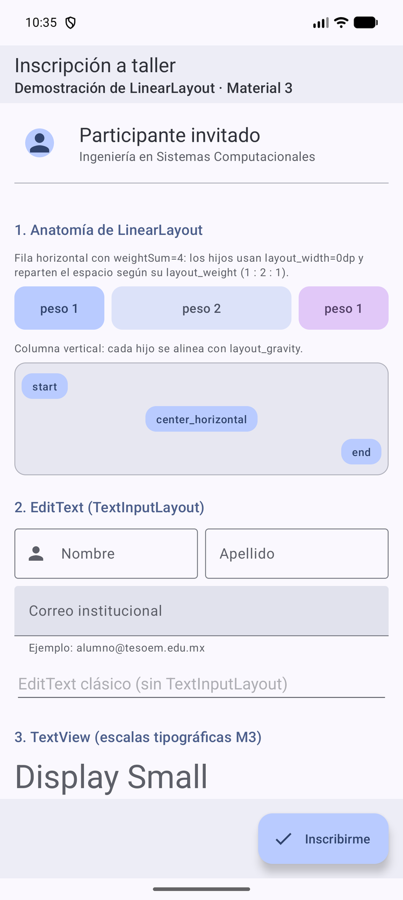
  &nbsp;&nbsp;
  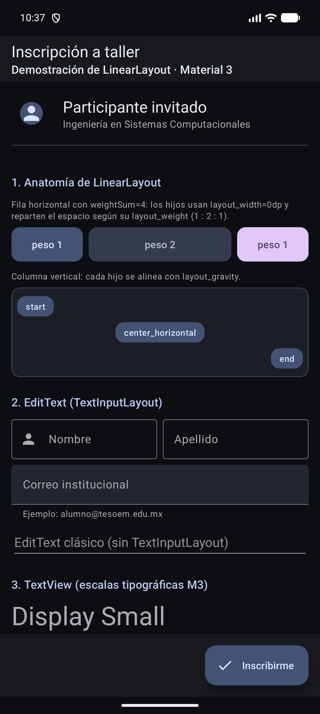
  <br><em>Capturas reales en el emulador Pixel 8 Pro (Android 17, API 37): modo claro y modo oscuro.</em>
</p>

---

## Contenido

1. [Requisitos y versiones](#1-requisitos-y-versiones)
2. [Compilar y ejecutar](#2-compilar-y-ejecutar)
3. [Estructura del proyecto](#3-estructura-del-proyecto)
4. [Arquitectura de la pantalla](#4-arquitectura-de-la-pantalla)
5. [LinearLayout: conceptos clave](#5-linearlayout-conceptos-clave)
6. [Cómo se activa Material Design 3](#6-cómo-se-activa-material-design-3)
7. [Cómo se activa Material You (color dinámico)](#7-cómo-se-activa-material-you-color-dinámico)
8. [Cómo se aplica Material 3 a vistas y componentes](#8-cómo-se-aplica-material-3-a-vistas-y-componentes)
9. [Recorrido por el código, sección por sección](#9-recorrido-por-el-código-sección-por-sección)
10. [Errores comunes](#10-errores-comunes)
11. [Fuentes consultadas](#11-fuentes-consultadas)

---

## 1. Requisitos y versiones

Valores tomados del propio proyecto y del equipo donde se compiló y probó.

| Elemento | Valor | Dónde se define u observa |
|---|---|---|
| Paquete (`namespace` / `applicationId`) | `mx.edu.tesoem.g7s12.p2_linearlayaut` | `app/build.gradle.kts` |
| `minSdk` / `targetSdk` / `compileSdk` | 31 / 37 / 37 | `app/build.gradle.kts` |
| Android Gradle Plugin | 9.4.1 | `gradle/libs.versions.toml` |
| Material Components for Android | 1.14.0 | `gradle/libs.versions.toml` |
| Gradle / JVM | 9.6.0 / JDK 25 | `./gradlew --version` |
| Lenguaje | Java 11 (`sourceCompatibility`) | `app/build.gradle.kts` |
| Tema base | `Theme.Material3.DayNight.NoActionBar` | `res/values/themes.xml` |
| Emulador de prueba | `Pixel_8_Pro`, Android 17 (API 37) | `adb shell getprop` |

`minSdk = 31` (Android 12) es justamente la versión en la que Android incorporó el color dinámico.

---

## 2. Compilar y ejecutar

Desde Android Studio basta con abrir la carpeta y pulsar **Run**. Desde la terminal:

```bash
$ cd ~/AndroidStudioProjects/P2LinearLayaut
$ ./gradlew assembleDebug
BUILD SUCCESSFUL in 8s
$ ~/Android/Sdk/emulator/emulator -list-avds
Pixel_8_Pro
$ ~/Android/Sdk/emulator/emulator -avd Pixel_8_Pro -no-snapshot-save -no-boot-anim &
$ adb shell getprop sys.boot_completed
1
$ adb install -r app/build/outputs/apk/debug/app-debug.apk
Performing Streamed Install
Success
$ adb shell am start -W -n mx.edu.tesoem.g7s12.p2_linearlayaut/.MainActivity
Starting: Intent { cmp=mx.edu.tesoem.g7s12.p2_linearlayaut/.MainActivity }
Status: ok
LaunchState: COLD
$ adb logcat -d -b crash
```

| Comando / parámetro | Significado |
|---|---|
| `./gradlew assembleDebug` | Ejecuta el Gradle Wrapper (versión fija de Gradle) y construye la variante *debug*: compila Java, enlaza recursos con AAPT2, genera DEX y firma con la llave de depuración. Resultado: `app/build/outputs/apk/debug/app-debug.apk`. |
| `emulator -list-avds` | Lista los dispositivos virtuales (AVD) creados en el SDK. |
| `-avd Pixel_8_Pro` | Nombre del AVD a arrancar. |
| `-no-snapshot-save` | No guarda el estado al cerrar; cada arranque parte del mismo punto. |
| `-no-boot-anim` | Omite la animación de arranque. |
| `&` | Ejecuta el emulador en segundo plano y devuelve el prompt. |
| `adb shell getprop sys.boot_completed` | Lee la propiedad del sistema que vale `1` cuando Android terminó de arrancar. |
| `adb install -r` | Instala el APK; `-r` reemplaza la versión instalada conservando sus datos. |
| `am start -W -n paquete/.Clase` | El Activity Manager inicia la Activity indicada; `-W` espera a que abra y reporta tiempos. `LaunchState: COLD` = el proceso se creó desde cero. |
| `adb logcat -d -b crash` | Vuelca (`-d`) el búfer de fallos (`-b crash`). Sin salida = la app no se cerró de forma inesperada. |

---

## 3. Estructura del proyecto

El proyecto parte de la plantilla **Empty Views Activity** de Android Studio (Java). Estos son los
archivos que la práctica **crea** o **modifica**; el resto (Gradle, temas, iconos de lanzador, pruebas)
se conserva tal como lo generó la plantilla.

```text
app/src/main/
├── AndroidManifest.xml ................. MODIFICADO: registra P2App y adjustResize
├── java/mx/edu/tesoem/g7s12/p2_linearlayaut/
│   ├── P2App.java ...................... CREADO: activa Material You (DynamicColors)
│   └── MainActivity.java ............... MODIFICADO: listeners de todos los componentes
└── res/
    ├── layout/activity_main.xml ........ MODIFICADO: pantalla completa con LinearLayout (799 líneas)
    ├── values/strings.xml .............. MODIFICADO: todos los textos de la interfaz
    ├── values/styles.xml ............... CREADO: estilos reutilizables y forma circular
    ├── values/themes.xml ............... plantilla: Theme.Material3.DayNight.NoActionBar
    ├── values-night/themes.xml ......... plantilla: variante para modo oscuro
    └── drawable/
        ├── divisor_8dp.xml ............. CREADO: separador para showDividers
        ├── fondo_bloque_primario.xml ... CREADO: fondo con ?attr/colorPrimaryContainer
        ├── fondo_bloque_secundario.xml . CREADO: fondo con ?attr/colorSecondaryContainer
        ├── fondo_bloque_terciario.xml .. CREADO: fondo con ?attr/colorTertiaryContainer
        ├── fondo_contenedor.xml ........ CREADO: superficie con borde
        └── ic_add / ic_check / ic_favorite / ic_person / ic_send.xml ... CREADOS: iconos vectoriales
```

---

## 4. Arquitectura de la pantalla

La raíz es un `LinearLayout` **vertical** con tres hijos. El área desplazable declara
`layout_height="0dp"` y `layout_weight="1"`, de modo que recibe **todo el alto que sobra** después de
medir las dos barras.

<p align="center">
  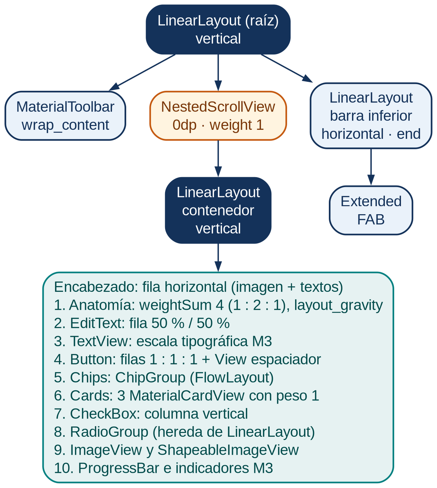
  <br><em>Árbol de vistas de <code>activity_main.xml</code>. En naranja, la vista que recibe el espacio sobrante.</em>
</p>

| Hijo de la raíz | Alto declarado | Resultado en pantalla |
|---|---|---|
| `MaterialToolbar` | `wrap_content` | Mide lo que necesitan título y subtítulo. |
| `NestedScrollView` | `0dp` + `layout_weight="1"` | Recibe todo el alto sobrante; su contenido se desplaza. |
| `LinearLayout` (barra inferior) | `wrap_content` | Queda siempre visible al pie, fuera del scroll. |

Fragmento de `res/layout/activity_main.xml` (área desplazable):

```xml
<!--
    layout_height="0dp" + layout_weight="1":
    el LinearLayout primero mide a los hermanos con tamaño fijo (Toolbar y
    barra inferior) y el espacio sobrante se entrega a esta vista.
    Así el scroll ocupa "todo lo que queda" sin tapar la barra inferior.
-->
<androidx.core.widget.NestedScrollView
    android:layout_width="match_parent"
    android:layout_height="0dp"
    android:layout_weight="1"
    android:clipToPadding="false">
```

Si el scroll usara `match_parent` empujaría la barra inferior fuera de la pantalla; con `wrap_content`
no ocuparía el alto disponible cuando el contenido es corto. El patrón «zonas fijas + una zona con
`0dp` y peso 1» resuelve ambos casos.

---

## 5. LinearLayout: conceptos clave

`LinearLayout` (paquete `android.widget`) es un `ViewGroup` que coloca a sus hijos **uno tras otro en
una sola dirección**: columna (`orientation="vertical"`) o fila (`"horizontal"`, valor por defecto). El
orden del XML es el orden en pantalla.

Todo `ViewGroup` dibuja en dos fases: **measure** (pregunta a cada hijo cuánto mide) y **layout** (le
asigna posición). Cuando hay pesos, LinearLayout mide primero a los hijos sin peso, calcula el sobrante
y lo reparte en proporción a `layout_weight ÷ weightSum`:

<p align="center">
  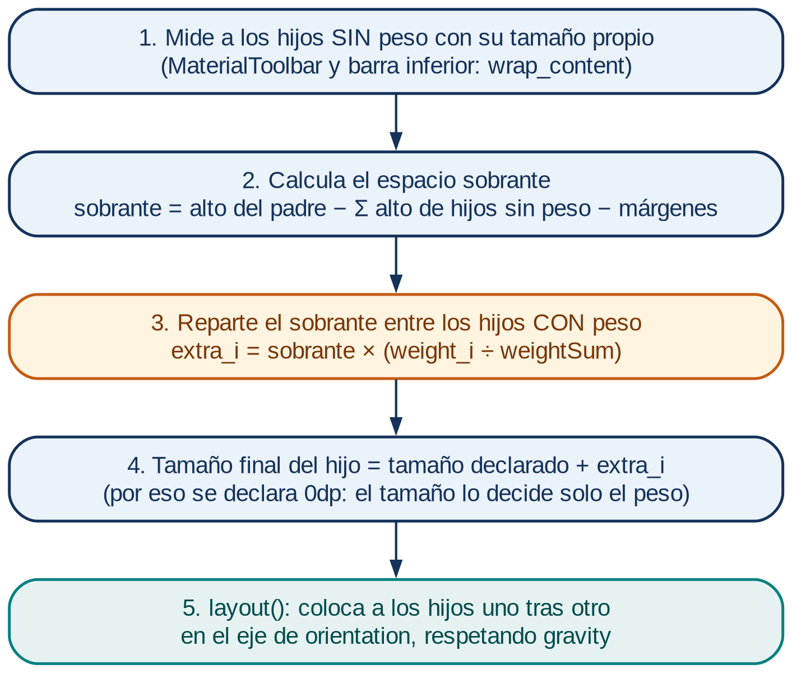
</p>

**Atributos del contenedor**

| Atributo | Efecto |
|---|---|
| `android:orientation` | Dirección en que se apilan los hijos. |
| `android:gravity` | Alinea el **contenido** dentro del propio contenedor (afecta a todos los hijos). |
| `android:weightSum` | Suma total de pesos; si se omite, es la suma de los `layout_weight` de los hijos. |
| `android:divider` + `android:showDividers` | Drawable que se dibuja entre hijos (`none`, `beginning`, `middle`, `end`). |
| `android:baselineAligned` | En filas, alinea por la línea base del texto; se desactiva cuando los hijos son contenedores. |

**Atributos que declaran los hijos** (`LinearLayout.LayoutParams`; el prefijo `layout_` indica algo que
el hijo le pide a su padre)

| Atributo | Efecto |
|---|---|
| `layout_width` / `layout_height` | `match_parent`, `wrap_content` o medida fija. Con peso se usa `0dp` en la dimensión que se reparte. |
| `layout_weight` | Fracción del espacio **sobrante** que recibe el hijo. |
| `layout_gravity` | Cómo pide el hijo ser alineado en el eje **perpendicular** a la orientación (solo le afecta a él). |
| `layout_margin*` | Espacio exterior; se descuenta antes de repartir el sobrante. |

> **Rendimiento.** Si un hijo con peso declara `wrap_content` en lugar de `0dp`, se mide dos veces
> (advertencia de Lint *InefficientWeight*). Anidar pesos dentro de pesos multiplica las mediciones
> (*NestedWeights*); en pantallas complejas conviene `ConstraintLayout`.

---

## 6. Cómo se activa Material Design 3

**Material Design 3** es el sistema de diseño de Google (roles de color, escala tipográfica, formas,
movimiento y especificación de componentes). En vistas XML se implementa con la biblioteca **Material
Components for Android**; según su guía *Getting started*, los temas `Material3` existen desde la
versión 1.5.0. Se requieren **tres piezas**:

### Pieza 1 · La dependencia

`gradle/libs.versions.toml` declara la versión y el alias:

```toml
[versions]
material = "1.14.0"

[libraries]
material = { group = "com.google.android.material", name = "material", version.ref = "material" }
```

y `app/build.gradle.kts` la incluye:

```kotlin
dependencies {
    implementation(libs.activity.ktx)
    implementation(libs.appcompat)
    implementation(libs.constraintlayout)
    implementation(libs.material)
    // ...pruebas
}
```

> Los scripts de Gradle usan Kotlin DSL (`.kts`) porque así los genera Android Studio; **todo el código
> de la aplicación es Java**.

Para confirmar la versión que realmente se empaqueta:

```bash
$ ./gradlew :app:dependencies --configuration debugRuntimeClasspath | grep "com.google.android.material"
\--- com.google.android.material:material:1.14.0
```

### Pieza 2 · Un tema que hereda de `Theme.Material3.*`

`res/values/themes.xml` (sin cambios respecto a la plantilla):

```xml
<style name="Base.Theme.P2LinearLayaut" parent="Theme.Material3.DayNight.NoActionBar">
    <!-- Customize your light theme here. -->
</style>

<style name="Theme.P2LinearLayaut" parent="Base.Theme.P2LinearLayaut" />
```

| Parte del nombre | Significado |
|---|---|
| `Theme.Material3` | Familia de temas M3. En la biblioteca 1.14.0 desciende de `Base.V14.Theme.Material3.Light`, que declara `isMaterial3Theme=true`, todos los roles de color, la tipografía, las formas y el estilo por defecto de cada componente. |
| `DayNight` | En `values/` equivale a `Theme.Material3.Light`; en `values-night/` (recurso de la biblioteca) a `Theme.Material3.Dark`. Android elige según el modo oscuro del sistema. |
| `NoActionBar` | Sin barra de acción del sistema; la pantalla dibuja su propia `MaterialToolbar`. |

El tema se asigna a toda la app en el manifiesto con `android:theme="@style/Theme.P2LinearLayaut"`.

### Pieza 3 · `AppCompatActivity` y el inflador Material

El tema M3 declara `viewInflaterClass = com.google.android.material.theme.MaterialComponentsViewInflater`.
`AppCompatActivity` usa esa clase al inflar el XML y **sustituye las etiquetas clásicas por su versión
Material** (verificado en el código compilado de la biblioteca 1.14.0):

| Etiqueta en el XML | Objeto que realmente se crea |
|---|---|
| `<Button>` | `com.google.android.material.button.MaterialButton` |
| `<CheckBox>` | `com.google.android.material.checkbox.MaterialCheckBox` |
| `<RadioButton>` | `com.google.android.material.radiobutton.MaterialRadioButton` |
| `<TextView>` | `com.google.android.material.textview.MaterialTextView` |
| `<AutoCompleteTextView>` | `com.google.android.material.textfield.MaterialAutoCompleteTextView` |

Por eso el layout escribe `<Button>` y en pantalla aparece un botón M3, y por eso `MainActivity` hereda
de `AppCompatActivity`:

```java
public class MainActivity extends AppCompatActivity {
```

> Si el tema de la app no es Material, al inflar un componente Material la biblioteca lanza
> `IllegalArgumentException: The style on this component requires your app theme to be
> Theme.MaterialComponents (or a descendant)` (clase `ThemeEnforcement`).

---

## 7. Cómo se activa Material You (color dinámico)

**Material You** es el nombre con que se conoce la personalización de Android 12 basada en el
**color dinámico**: según la documentación de Android, el sistema detecta los colores principales del
fondo de pantalla (o usa el color elegido por el usuario), extrae un *color fuente* y genera con él
paletas tonales que las apps pueden adoptar.

### `P2App.java` (archivo creado)

```java
public class P2App extends Application {

    @Override
    public void onCreate() {
        super.onCreate();
        // Si el dispositivo no soporta color dinámico, se conserva la paleta base del tema.
        DynamicColors.applyToActivitiesIfAvailable(this);
    }
}
```

- `Application` se instancia **una sola vez y antes que cualquier Activity**: es el lugar indicado para
  configuraciones globales.
- `DynamicColors.applyToActivitiesIfAvailable(this)` registra un `ActivityLifecycleCallbacks` que, en
  `onActivityPreCreated()` de cada Activity (antes de que infle su layout), aplica al tema el overlay
  definido en el atributo `dynamicColorThemeOverlay` (`ThemeOverlay.Material3.DynamicColors.Light` o
  `.Dark`).
- Si el dispositivo no lo admite, no hace nada. `DynamicColors.isDynamicColorAvailable()` devuelve
  `false` en API < 31, `true` en API ≥ 33 y, en API 31–32, consulta una lista interna de fabricantes.

### Registro en `AndroidManifest.xml` (archivo modificado)

```xml
<application
    android:name=".P2App"
    ...
    android:theme="@style/Theme.P2LinearLayaut">
    <activity
        android:name=".MainActivity"
        android:exported="true"
        android:windowSoftInputMode="adjustResize">
```

Sin `android:name=".P2App"` Android usaría la clase `Application` por defecto y el color dinámico
nunca se activaría. `adjustResize` hace que el teclado reduzca la ventana en lugar de tapar los campos.

### Del fondo de pantalla al botón

La cadena completa por la que el botón **Filled** obtiene su color, verificada en los recursos de
Material Components 1.14.0:

<p align="center">
  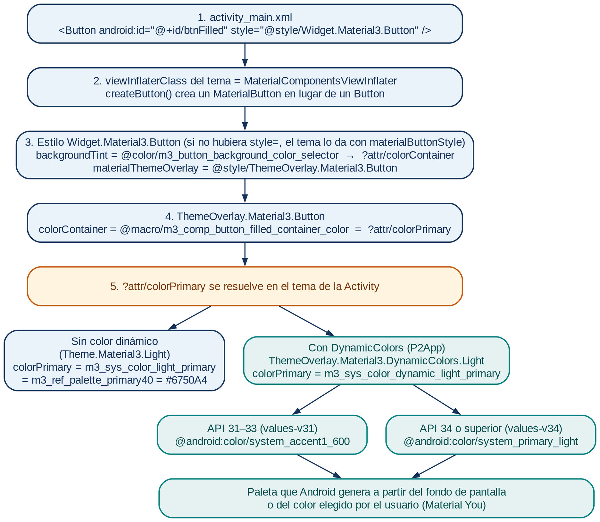
</p>

Sin color dinámico, `colorPrimary` vale `#6750A4` (morado base de M3). Con `DynamicColors`, apunta a
colores del sistema: `@android:color/system_accent1_600` en API 31–33 y
`@android:color/system_primary_light` en API 34 o superior.

### Prueba real: otra paleta, la misma APK

La elección de «Fondo de pantalla y estilo» se guarda en la clave segura
`theme_customization_overlay_packages`; escribirla con `adb` produce el mismo efecto:

```bash
$ PALETA='{"android.theme.customization.system_palette":"2E7D32","android.theme.customization.accent_color":"2E7D32","android.theme.customization.color_source":"preset","android.theme.customization.theme_style":"TONAL_SPOT"}'
$ adb shell settings put secure theme_customization_overlay_packages "'$PALETA'"
$ adb shell am force-stop mx.edu.tesoem.g7s12.p2_linearlayaut
$ adb shell am start -W -n mx.edu.tesoem.g7s12.p2_linearlayaut/.MainActivity
Status: ok
LaunchState: COLD
$ adb shell settings delete secure theme_customization_overlay_packages
Deleted 1 rows
```

| Comando / parámetro | Significado |
|---|---|
| `PALETA='{…}'` | Variable local con el JSON; las comillas simples protegen las comillas dobles internas. |
| `system_palette` / `accent_color` | Color fuente (hexadecimal sin `#`) del que se generan las paletas. |
| `color_source: preset` | Color elegido fijo, no extraído del fondo de pantalla. |
| `theme_style: TONAL_SPOT` | Estilo de generación de paletas (el predeterminado de Android). |
| `settings put secure` | Escribe la clave; `"'$PALETA'"` hace que la shell del dispositivo reciba el JSON como un solo argumento. |
| `am force-stop` | Termina el proceso para que el siguiente inicio sea en frío y relea el tema. |
| `settings delete secure` | Restaura la paleta obtenida del fondo de pantalla. |

<p align="center">
  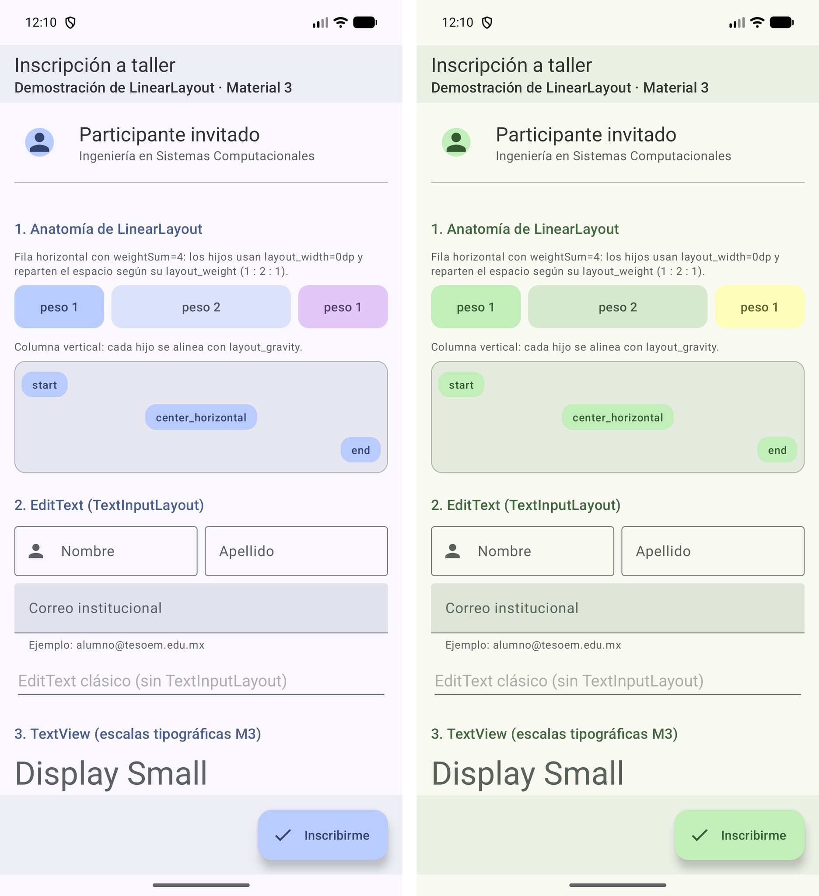
  <br><em>Captura real: izquierda, paleta del fondo del emulador; derecha, paleta generada desde #2E7D32. El código no se modificó ni se recompiló.</em>
</p>

---

## 8. Cómo se aplica Material 3 a vistas y componentes

Un mismo atributo puede venir de varios lugares. La guía *Styles and themes* de Android fija esta
precedencia (de mayor a menor): *spans* de texto → atributos asignados por código → atributos escritos
en la vista → `style` → estilo por defecto del componente → tema → `android:textAppearance`.
Material 3 usa estos niveles así:

| Mecanismo | Cómo se escribe | Ejemplo en el proyecto |
|---|---|---|
| Rol de color del tema | `?attr/colorPrimaryContainer` | Fondos `fondo_bloque_*.xml`, raíz con `?attr/colorSurface` |
| Estilo por defecto del componente | El tema define `materialButtonStyle`, `chipStyle`, `radioButtonStyle`… | `<RadioButton>` sin `style` → `Widget.Material3.CompoundButton.RadioButton` |
| Estilo de la instancia | `style="@style/Widget.Material3.…"` | Variantes de botón, chips y tarjetas |
| Overlay de tema del componente | `materialThemeOverlay` dentro del estilo | `Widget.Material3.Button` → `ThemeOverlay.Material3.Button` |
| Overlay de tema de una vista | `android:theme="@style/ThemeOverlay…"` | Cambia el tema de la vista **y de sus hijos** (no se usa aquí) |
| Escala tipográfica | `android:textAppearance="?attr/textAppearanceTitleMedium"` | Títulos y sección 3 de la pantalla |
| Escala de formas | `app:shapeAppearanceOverlay` | Avatar circular (`ShapeAppearance.P2.Circulo`) |

### Roles de color: `?attr` en lugar de colores fijos

M3 no asigna colores a los componentes sino **roles** (`colorPrimary`, `colorSecondaryContainer`,
`colorSurfaceContainerHigh`, `colorOutlineVariant`…). Cada rol tiene su pareja **on** (`colorOnPrimary`,
`colorOnPrimaryContainer`…) para el texto o icono que va encima, lo que garantiza contraste.

`?attr/nombre` significa «lee el valor que el **tema actual** asigna a este atributo»; por eso cambia con
el modo oscuro y con Material You. `@color/nombre`, en cambio, es fijo. Ejemplo,
`res/drawable/fondo_bloque_primario.xml`:

```xml
<!-- Fondo redondeado con el color de rol "colorPrimaryContainer" del tema (cambia con Material You). -->
<shape xmlns:android="http://schemas.android.com/apk/res/android"
    android:shape="rectangle">
    <corners android:radius="12dp" />
    <solid android:color="?attr/colorPrimaryContainer" />
</shape>
```

Los iconos vectoriales siguen la misma regla: se tiñen con `android:tint="?attr/colorControlNormal"`.

### Estilos por defecto del tema (Material Components 1.14.0)

| Atributo del tema | Estilo por defecto | Componente |
|---|---|---|
| `materialButtonStyle` | `Widget.Material3.Button` (Filled) | `Button` / `MaterialButton` |
| `checkboxStyle` | `Widget.Material3.CompoundButton.CheckBox` | `CheckBox` |
| `radioButtonStyle` | `Widget.Material3.CompoundButton.RadioButton` | `RadioButton` |
| `chipStyle` | `Widget.Material3.Chip.Assist` | `Chip` |
| `materialCardViewStyle` | `Widget.Material3.CardView.Outlined` | `MaterialCardView` |
| `textInputStyle` | `Widget.Material3.TextInputLayout.OutlinedBox` | `TextInputLayout` |
| `toolbarStyle` | `Widget.Material3.Toolbar` | `MaterialToolbar` |
| `linearProgressIndicatorStyle` | `Widget.Material3.LinearProgressIndicator` | `LinearProgressIndicator` |
| `snackbarStyle` | `Widget.Material3.Snackbar` | `Snackbar` |

Para cambiar **todas** las instancias de un componente se sobrescribe el atributo en el tema propio;
para cambiar **una sola**, se escribe `style` en la etiqueta.

### Estilos propios: `res/values/styles.xml` (archivo creado)

```xml
<!-- Título de cada sección (escala TitleMedium, color primario) -->
<style name="P2.TituloSeccion" parent="">
    <item name="android:layout_width">match_parent</item>
    <item name="android:layout_height">wrap_content</item>
    <item name="android:layout_marginTop">24dp</item>
    <item name="android:layout_marginBottom">8dp</item>
    <item name="android:textAppearance">?attr/textAppearanceTitleMedium</item>
    <item name="android:textColor">?attr/colorPrimary</item>
</style>

<!-- Bloque de la demostración de pesos: ancho 0dp para que mande layout_weight -->
<style name="P2.BloquePeso" parent="">
    <item name="android:layout_width">0dp</item>
    <item name="android:layout_height">match_parent</item>
    <item name="android:gravity">center</item>
    <item name="android:textAppearance">?attr/textAppearanceLabelLarge</item>
</style>

<!-- Forma circular (esquinas al 50 %) para ShapeableImageView -->
<style name="ShapeAppearance.P2.Circulo" parent="">
    <item name="cornerFamily">rounded</item>
    <item name="cornerSize">50%</item>
</style>
```

- Un estilo agrupa atributos repetidos (principio DRY) y se aplica con `style="@style/P2.TituloSeccion"`.
- **`parent=""` es obligatorio aquí**: en los recursos de Android, un nombre con punto (`P2.TituloSeccion`)
  implica herencia del estilo `P2`. Como no existe, AAPT2 detiene la compilación con
  `error: resource style/P2 ... not found`. `parent=""` indica que no hereda de nadie.
- Los estilos combinan medidas de layout, la escala tipográfica M3 (`?attr/textAppearance…`) y roles de
  color (`?attr/colorPrimary`).

---

## 9. Recorrido por el código, sección por sección

Los bloques siguientes son **extractos** de los archivos reales. Las partes omitidas se señalan con un
comentario (`<!-- … misma estructura -->`, `// …`) o con `...`; el código completo está en cada archivo
del repositorio.

### 9.1 `MainActivity.onCreate()`: edge-to-edge e insets

```java
@Override
protected void onCreate(Bundle savedInstanceState) {
    super.onCreate(savedInstanceState);

    // Dibuja detrás de las barras del sistema (edge-to-edge, obligatorio desde API 35)
    EdgeToEdge.enable(this);
    setContentView(R.layout.activity_main);

    raiz = findViewById(R.id.main);
    aplicarInsets();

    configurarEditText();
    configurarBotones();
    configurarChips();
    configurarCards();
    configurarCheckBoxes();
    configurarRadioButtons();
    configurarProgreso();
}

private void aplicarInsets() {
    ViewCompat.setOnApplyWindowInsetsListener(raiz, (v, insets) -> {
        Insets barras = insets.getInsets(WindowInsetsCompat.Type.systemBars()
                | WindowInsetsCompat.Type.ime());
        v.setPadding(barras.left, barras.top, barras.right, barras.bottom);
        return insets;
    });
}
```

- Desde Android 15 (API 35) las apps que apuntan a ese nivel se dibujan detrás de la barra de estado y
  de navegación (**edge-to-edge**). `EdgeToEdge.enable(this)` lo activa también en versiones previas.
- Los **insets** son el tamaño de esas barras; el listener los convierte en padding del LinearLayout raíz
  para que nada quede oculto. `systemBars() | ime()` suma barras del sistema y teclado.
- Al llegar a `setContentView()` el color dinámico ya está aplicado (P2App lo hizo en
  `onActivityPreCreated`).
- Cada `configurar…()` engancha los listeners de un componente.

### 9.2 Anatomía de LinearLayout: `weightSum`, `showDividers` y `layout_gravity`

<p align="center">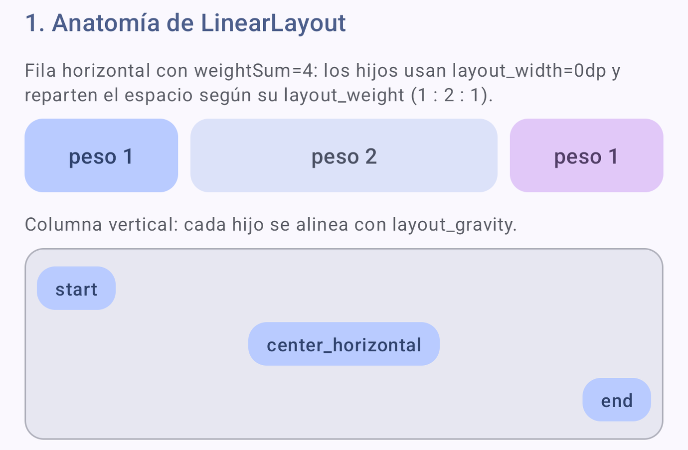</p>

```xml
<!--
    weightSum="4": la suma total de pesos es 4.
    Hijos: 1 + 2 + 1 = 4 → 25 % | 50 % | 25 % del ancho.
    showDividers + divider: dibuja un separador ENTRE hijos
    (atributos propios de LinearLayout).
-->
<LinearLayout
    android:layout_width="match_parent"
    android:layout_height="48dp"
    android:divider="@drawable/divisor_8dp"
    android:orientation="horizontal"
    android:showDividers="middle"
    android:weightSum="4">

    <TextView
        style="@style/P2.BloquePeso"
        android:layout_weight="1"
        android:background="@drawable/fondo_bloque_primario"
        android:text="@string/peso_1"
        android:textColor="?attr/colorOnPrimaryContainer" />

    <TextView
        style="@style/P2.BloquePeso"
        android:layout_weight="2"
        android:background="@drawable/fondo_bloque_secundario"
        android:text="@string/peso_2"
        android:textColor="?attr/colorOnSecondaryContainer" />

    <TextView
        style="@style/P2.BloquePeso"
        android:layout_weight="1"
        android:background="@drawable/fondo_bloque_terciario"
        android:text="@string/peso_1"
        android:textColor="?attr/colorOnTertiaryContainer" />
</LinearLayout>
```

- `P2.BloquePeso` pone `layout_width="0dp"`: el ancho lo decide solo el peso.
- Cada bloque usa un fondo `…Container` y el texto con su pareja `colorOn…Container` (contraste
  garantizado por el tema).
- `divisor_8dp.xml` es un `shape` transparente de 8 dp: solo aporta espacio entre bloques.

En la columna de debajo, cada hijo pide su posición horizontal con `layout_gravity`:

```xml
<TextView
    style="@style/P2.EtiquetaGravedad"
    android:layout_gravity="center_horizontal"
    android:text="@string/gravedad_centro" />
```

`gravity` lo escribe el contenedor y afecta a todos sus hijos; `layout_gravity` lo escribe un hijo y le
afecta solo a él.

### 9.3 EditText y TextView

<p align="center">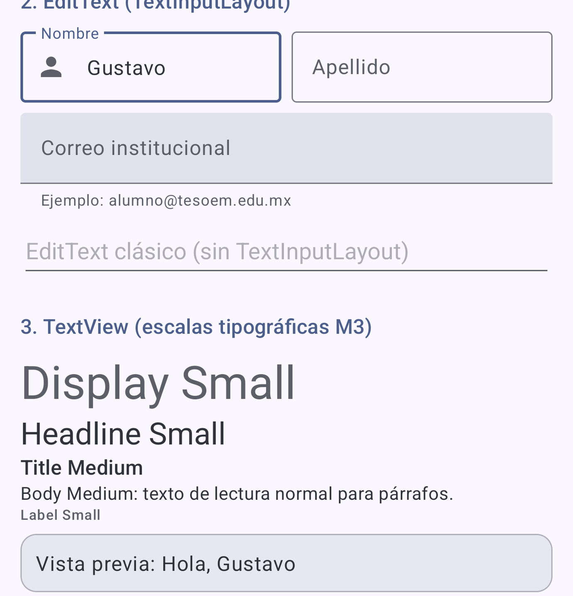</p>

```xml
<LinearLayout
    android:layout_width="match_parent"
    android:layout_height="wrap_content"
    android:orientation="horizontal">

    <com.google.android.material.textfield.TextInputLayout
        style="@style/Widget.Material3.TextInputLayout.OutlinedBox"
        android:layout_width="0dp"
        android:layout_height="wrap_content"
        android:layout_marginEnd="8dp"
        android:layout_weight="1"
        android:hint="@string/hint_nombre"
        app:startIconDrawable="@drawable/ic_person">

        <com.google.android.material.textfield.TextInputEditText
            android:id="@+id/etNombre"
            android:layout_width="match_parent"
            android:layout_height="wrap_content"
            android:inputType="textPersonName|textCapWords" />
    </com.google.android.material.textfield.TextInputLayout>

    <!-- Apellido: misma estructura, también con layout_weight="1" -->
</LinearLayout>
```

- `TextInputLayout` es el contenedor M3: dibuja el borde, la etiqueta flotante (`hint`), el texto de
  ayuda y los iconos. Dentro va un `TextInputEditText`, subclase de `EditText`.
- Nombre y Apellido tienen `0dp` + peso 1: cada uno recibe el 50 % del ancho.
- `inputType="textPersonName|textCapWords"` elige el teclado y pone mayúscula inicial en cada palabra.

En Java, un `TextWatcher` copia lo escrito a un `TextView` de vista previa:

```java
etNombre.addTextChangedListener(new TextWatcher() {
    // beforeTextChanged() y onTextChanged() no se requieren

    @Override
    public void afterTextChanged(Editable s) {
        String nombre = s.toString().trim();
        if (nombre.isEmpty()) {
            tvVistaPrevia.setText(R.string.tv_preview_vacio);
        } else {
            tvVistaPrevia.setText(getString(R.string.tv_preview, nombre));
        }
    }
});
```

`getString(R.string.tv_preview, nombre)` rellena el marcador de formato del texto en `strings.xml`.
Los `TextView` de la sección 3 aplican la escala tipográfica M3 (15 estilos: Display, Headline, Title,
Body y Label en tamaños Large, Medium y Small) con `android:textAppearance="?attr/textAppearance…"`.

### 9.4 Button y sus variantes

<p align="center">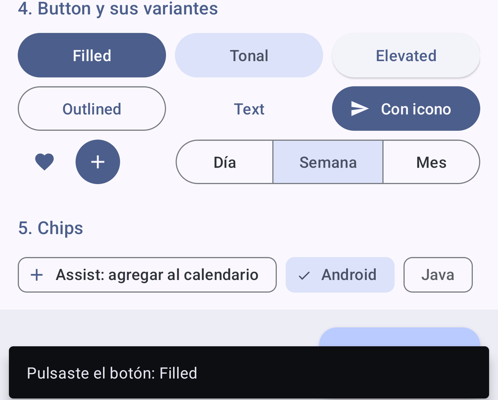</p>

```xml
<!-- Filled (estilo por defecto de Button en un tema M3) -->
<Button
    android:id="@+id/btnFilled"
    style="@style/Widget.Material3.Button"
    android:layout_width="0dp"
    android:layout_height="wrap_content"
    android:layout_weight="1"
    android:text="@string/btn_filled" />
```

| Variante | Estilo |
|---|---|
| Filled | `Widget.Material3.Button` |
| Filled tonal | `Widget.Material3.Button.TonalButton` |
| Elevated | `Widget.Material3.Button.ElevatedButton` |
| Outlined | `Widget.Material3.Button.OutlinedButton` |
| Text | `Widget.Material3.Button.TextButton` |
| Icon button | `Widget.Material3.Button.IconButton` / `.IconButton.Filled` |
| Segmentado | `MaterialButtonToggleGroup` con botones Outlined |
| Extended FAB | `ExtendedFloatingActionButton` (barra inferior) |

Un `View` vacío con peso 1 sirve de **espaciador** y empuja el grupo segmentado a la derecha:

```xml
<!-- Espaciador: vista vacía con peso 1 que empuja el grupo a la derecha -->
<View
    android:layout_width="0dp"
    android:layout_height="0dp"
    android:layout_weight="1" />
```

En Java, un ciclo asigna el mismo listener a las seis variantes con texto:

```java
int[] ids = {
        R.id.btnFilled, R.id.btnTonal, R.id.btnElevated,
        R.id.btnOutlined, R.id.btnText, R.id.btnIcono
};
for (int id : ids) {
    Button boton = findViewById(id);
    boton.setOnClickListener(v -> mostrarMensaje(
            getString(R.string.msg_boton, boton.getText())));
}

// Grupo segmentado: informa qué opción quedó marcada
com.google.android.material.button.MaterialButtonToggleGroup grupo =
        findViewById(R.id.toggleGrupo);
grupo.addOnButtonCheckedListener((g, idBoton, marcado) -> {
    if (marcado) {
        Button b = findViewById(idBoton);
        mostrarMensaje(getString(R.string.msg_boton, b.getText()));
    }
});
```

`mostrarMensaje()` muestra un **Snackbar**, el mensaje breve de Material que aparece al pie:

```java
private void mostrarMensaje(String texto) {
    Snackbar.make(raiz, texto, Snackbar.LENGTH_SHORT).show();
}
```

### 9.5 Chips

<p align="center">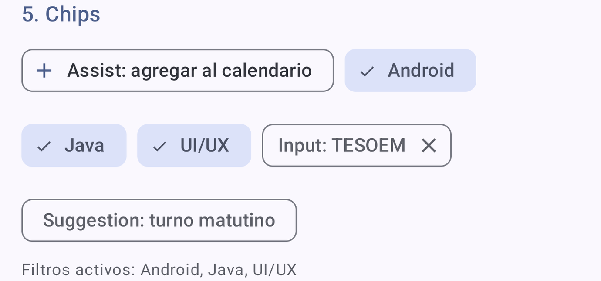</p>

```xml
<com.google.android.material.chip.ChipGroup
    android:id="@+id/chipGroup"
    android:layout_width="match_parent"
    android:layout_height="wrap_content">

    <com.google.android.material.chip.Chip
        android:id="@+id/chipAndroid"
        style="@style/Widget.Material3.Chip.Filter"
        android:layout_width="wrap_content"
        android:layout_height="wrap_content"
        android:checked="true"
        android:text="@string/chip_filter_android" />

    <com.google.android.material.chip.Chip
        android:id="@+id/chipInput"
        style="@style/Widget.Material3.Chip.Input"
        android:layout_width="wrap_content"
        android:layout_height="wrap_content"
        android:text="@string/chip_input" />
    <!-- además: Assist, dos Filter más y Suggestion -->
</com.google.android.material.chip.ChipGroup>
```

| Tipo | Estilo | Comportamiento |
|---|---|---|
| Assist | `Widget.Material3.Chip.Assist` | Acción sugerida con icono. |
| Filter | `Widget.Material3.Chip.Filter` | Se marca y desmarca; actualiza «Filtros activos». |
| Input | `Widget.Material3.Chip.Input` | Dato capturado; su icono de cierre lo elimina. |
| Suggestion | `Widget.Material3.Chip.Suggestion` | Opción sugerida de forma dinámica. |

> `ChipGroup` **no** es un LinearLayout: hereda de `FlowLayout` y salta a la siguiente fila cuando los
> chips no caben. LinearLayout nunca salta de línea; los hijos que no caben quedan recortados.

```java
Chip chipInput = findViewById(R.id.chipInput);
chipInput.setOnCloseIconClickListener(v -> {
    grupo.removeView(v);
    mostrarMensaje(getString(R.string.msg_chip_eliminado));
});
```

### 9.6 Cards, CheckBox y RadioButton

<p align="center">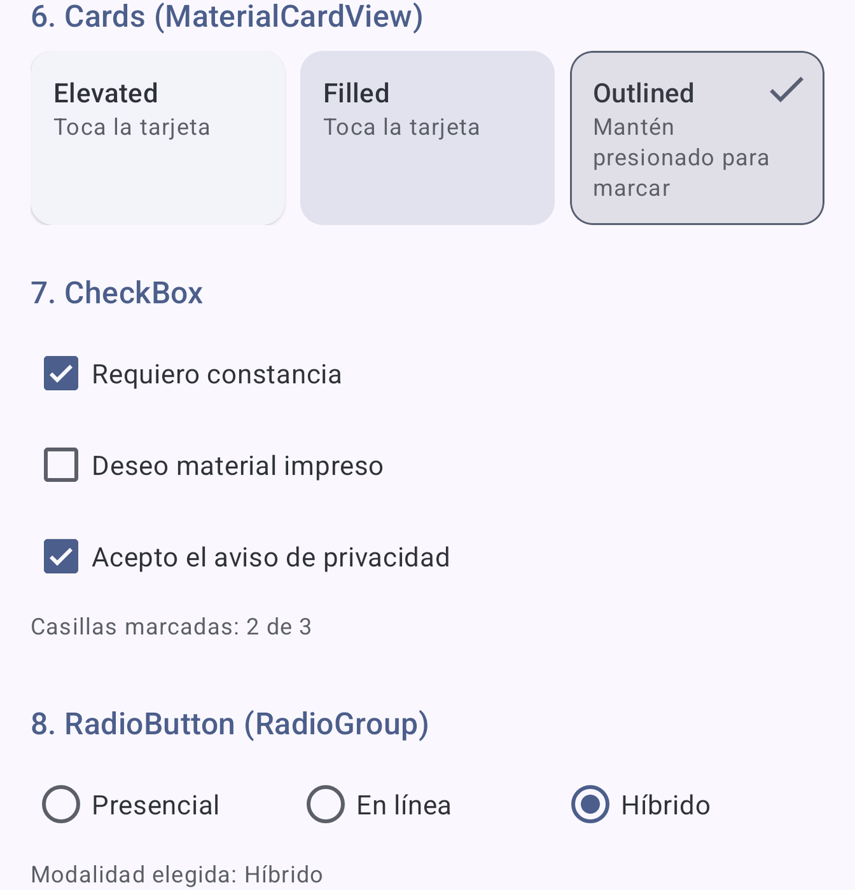</p>

Tres `MaterialCardView` (Elevated, Filled, Outlined) se reparten la fila con peso 1; dentro usan otra
vez un LinearLayout vertical (estilo `P2.InteriorTarjeta`):

```xml
<LinearLayout
    android:layout_width="match_parent"
    android:layout_height="wrap_content"
    android:baselineAligned="false"
    android:orientation="horizontal">

    <com.google.android.material.card.MaterialCardView
        android:id="@+id/cardElevated"
        style="@style/Widget.Material3.CardView.Elevated"
        android:layout_width="0dp"
        android:layout_height="match_parent"
        android:layout_weight="1"
        android:clickable="true"
        android:focusable="true">

        <!-- Interior de la tarjeta: también es un LinearLayout -->
        <LinearLayout style="@style/P2.InteriorTarjeta">
            <!-- título y descripción -->
        </LinearLayout>
    </com.google.android.material.card.MaterialCardView>
    <!-- cardFilled y cardOutlined (checkable) con la misma estructura -->
</LinearLayout>
```

`baselineAligned="false"` evita una medición adicional, porque los hijos son contenedores sin una línea
base de texto útil. La tarjeta Outlined es `checkable` y se marca con una pulsación larga:

```java
outlined.setOnLongClickListener(v -> {
    outlined.toggle(); // alterna el estado "checked" y muestra/oculta el icono
    return true;
});
```

`CheckBox` permite **selección múltiple**; `RadioButton` **selección única** dentro de un `RadioGroup`.
Dato clave: **`RadioGroup` hereda de `LinearLayout`**, por eso acepta `orientation` y sus hijos usan pesos:

```xml
<RadioGroup
    android:id="@+id/rgModalidad"
    android:layout_width="match_parent"
    android:layout_height="wrap_content"
    android:checkedButton="@+id/rbPresencial"
    android:orientation="horizontal">

    <RadioButton
        android:id="@+id/rbPresencial"
        android:layout_width="0dp"
        android:layout_height="wrap_content"
        android:layout_weight="1"
        android:text="@string/rb_presencial" />
    <!-- rbLinea y rbHibrido: misma estructura -->
</RadioGroup>
```

```java
grupo.setOnCheckedChangeListener((g, idMarcado) -> mostrarModalidad(idMarcado));
mostrarModalidad(grupo.getCheckedRadioButtonId());
```

### 9.7 ImageView y ProgressBar

<p align="center">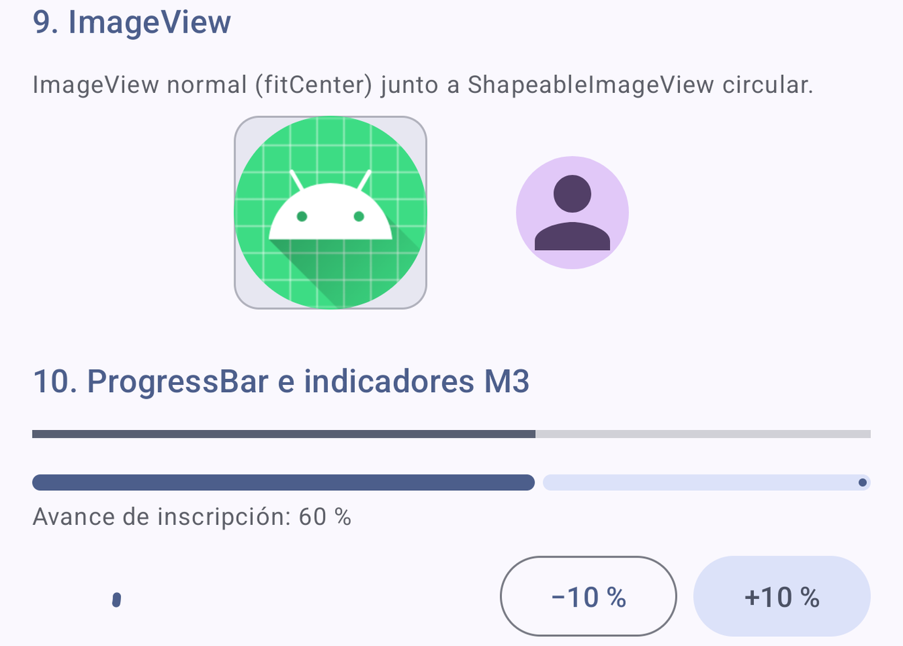</p>

```xml
<com.google.android.material.imageview.ShapeableImageView
    android:layout_width="96dp"
    android:layout_height="96dp"
    android:layout_marginStart="24dp"
    android:background="?attr/colorTertiaryContainer"
    android:contentDescription="@string/cd_avatar"
    android:padding="20dp"
    android:scaleType="fitCenter"
    android:src="@drawable/ic_person"
    app:shapeAppearanceOverlay="@style/ShapeAppearance.P2.Circulo"
    app:tint="?attr/colorOnTertiaryContainer" />
```

`ShapeableImageView` es la versión Material de `ImageView`: recorta la imagen con la forma de
`shapeAppearanceOverlay` (aquí, el círculo con esquinas al 50 % de `styles.xml`). `scaleType` define cómo
se ajusta la imagen; `contentDescription` es el texto que lee el lector de pantalla (accesibilidad).

Se comparan tres indicadores: el `ProgressBar` clásico horizontal, el `LinearProgressIndicator` M3
(determinado) y el `CircularProgressIndicator` (indeterminado, `android:indeterminate="true"`). Los
botones −10 % y +10 % actualizan los dos determinados:

```java
private void cambiarProgreso(int delta) {
    // Se limita el valor al rango 0..100
    int valor = Math.max(0, Math.min(100, pbClasico.getProgress() + delta));
    pbClasico.setProgress(valor);
    lpiAvance.setProgressCompat(valor, true); // true = animación suave
    tvProgreso.setText(getString(R.string.msg_progreso, valor));
}
```

### 9.8 Barra inferior fija

```xml
<LinearLayout
    android:layout_width="match_parent"
    android:layout_height="wrap_content"
    android:background="?attr/colorSurfaceContainer"
    android:clipChildren="false"
    android:clipToPadding="false"
    android:gravity="end"
    android:orientation="horizontal"
    android:padding="16dp">

    <com.google.android.material.floatingactionbutton.ExtendedFloatingActionButton
        android:id="@+id/fabInscribirme"
        android:layout_width="wrap_content"
        android:layout_height="wrap_content"
        android:text="@string/btn_inscribirme"
        app:icon="@drawable/ic_check" />
</LinearLayout>
```

`gravity="end"` alinea el botón a la derecha. `clipChildren="false"` y `clipToPadding="false"` permiten
que la sombra del botón se dibuje sobre el relleno; sin ellos la sombra aparecía cortada en el emulador.

### 9.9 Textos: `res/values/strings.xml`

Todos los textos están en `strings.xml`, lo que permite traducir la app sin tocar el layout (bastaría con
crear `res/values-en/strings.xml`). Los marcadores `%1$s` (texto) y `%1$d` (entero) se rellenan desde Java
con `getString(R.string.nombre, valor)`.

---

## 10. Errores comunes

| Síntoma | Causa | Solución |
|---|---|---|
| `AAPT: error: resource style/P2 ... not found` | Estilo con punto en el nombre sin `parent`. | Agregar `parent=""` o crear el estilo padre. |
| `IllegalArgumentException: The style on this component requires your app theme to be Theme.MaterialComponents (or a descendant)` | El tema de la app no es Material. | Heredar de `Theme.Material3.*`. |
| `<Button>` se ve como botón clásico | La Activity hereda de `Activity` y no usa el inflador Material. | Heredar de `AppCompatActivity`. |
| Un hijo con peso no ocupa lo esperado | `wrap_content` o `match_parent` en la dimensión que se reparte. | Usar `0dp`. |
| La barra inferior desaparece | `NestedScrollView` con `match_parent`. | `layout_height="0dp"` + `layout_weight="1"`. |
| Los colores no cambian con el fondo de pantalla | Falta `android:name=".P2App"`, el dispositivo es anterior a Android 12 o la vista usa un color fijo. | Registrar la clase Application y usar `?attr/…`. |
| La app no cambia de paleta tras `settings put` | El proceso seguía vivo con el tema anterior. | `adb shell am force-stop <paquete>` y volver a iniciarla. |
| El contenido queda detrás de la barra de estado | Edge-to-edge sin aplicar insets. | `setOnApplyWindowInsetsListener` sobre la raíz. |
| `INSTALL_FAILED_UPDATE_INCOMPATIBLE` | Hay una app con el mismo paquete y otra firma. | `adb uninstall mx.edu.tesoem.g7s12.p2_linearlayaut` y reinstalar. |

---

## 11. Fuentes consultadas

- Material Components for Android: `docs/getting-started.md`, `docs/theming/Color.md`,
  `docs/theming/Typography.md` y `docs/theming/Shape.md` en
  <https://github.com/material-components/material-components-android>.
- Android Developers: [Dynamic color](https://developer.android.com/develop/ui/views/theming/dynamic-colors)
  y [Styles and themes](https://developer.android.com/develop/ui/views/theming/themes).
- Recursos y clases compilados de `com.google.android.material:material:1.14.0` (temas, overlays, estilos
  por defecto, `DynamicColors` y `MaterialComponentsViewInflater`), revisados en la caché de Gradle del
  proyecto.

Todas las capturas son reales, tomadas del emulador Pixel 8 Pro (Android 17, API 37) con la APK de este
repositorio.
